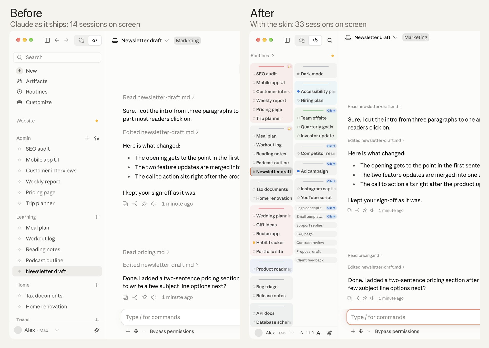
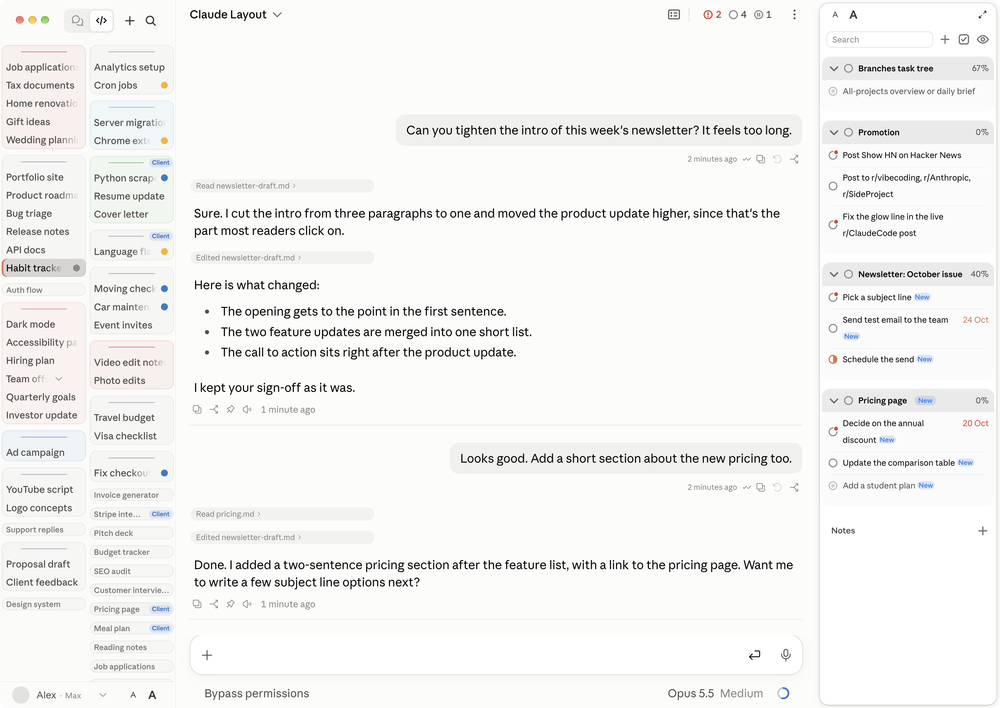
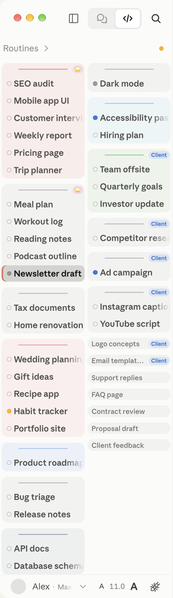
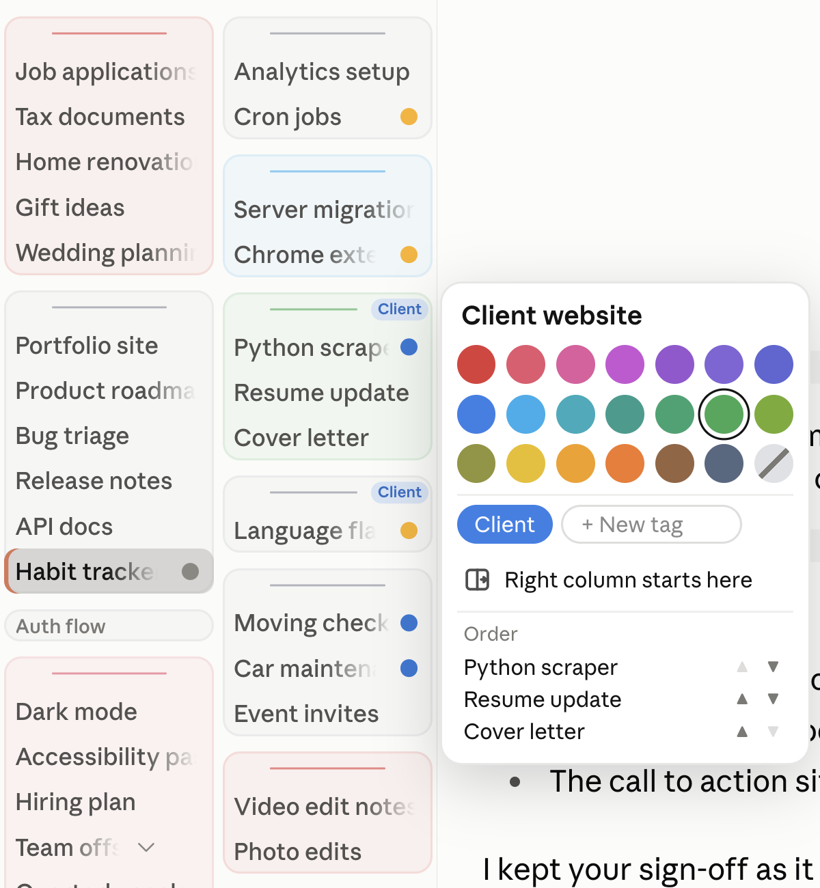
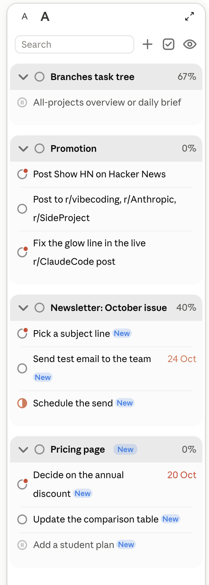

# Claude Desktop Skin

A custom layout for the **Claude desktop app** (the Code tab): a two-column sidebar, project colours and tags, a wider chat, and less wasted space everywhere.

It is plain CSS and JavaScript that runs in the app's own developer console. Nothing in the app is modified on disk, and a restart brings back the original look. You can set it up by hand, or paste one prompt into Claude and let it walk you through.





<p>
  
  
  
</p>

<sub>Screenshots use made-up project and session names.</sub>

> Unofficial. Not made by, affiliated with, or endorsed by Anthropic.

## The easy way: let Claude set it up for you

You don't need to understand any code. Open a new session in the Claude desktop app's **Code** tab, paste the prompt below, and Claude walks you through everything one step at a time: what the skin changes, turning on Developer Mode, applying it, and making it apply itself every time Claude opens.

```text
I want to customise the layout of my Claude desktop app with Claude Desktop Skin:
https://github.com/mohannad789/claude-desktop-skin

Please download it into a folder called claude-desktop-skin in my home folder (git clone, or the ZIP if git
isn't available), then read its CLAUDE.md and follow it. Walk me through the setup one step at a time, in plain
language, and wait for me whenever a step needs me to click something. Before applying anything, tell me in a
few lines what it will change, and check that the code makes no network requests.
```

After that, the same session is your helper:

- **Change anything you like:** "make the sidebar text bigger", "use a different colour for the glow", "turn off the bold session names". It edits the skin and re-applies it.
- **Fix it after a Claude update:** if something looks wrong after Claude updates itself, tell the session what you see. `CLAUDE.md` explains how to find what changed and fix it.
- **Don't want my layout?** Ask it to start from a clean skin and build your own. My version is just the one I spent many hours tuning for a lot of projects and sessions.

## Set it up by hand

### 1. Get the files

Click the green **Code** button at the top of this page, then **Download ZIP**. Unzip it and put the `claude-desktop-skin` folder somewhere it can stay, for example your home folder.

### 2. Turn on Developer Mode in Claude (once)

In the Claude app's menu bar, go to **Help → Troubleshooting → Enable Developer Mode**.

### 3. Apply the skin

1. In Claude, press **Cmd+Option+I** (Ctrl+Shift+I on Windows) to open the developer console, and click the **Console** tab.
2. Open [`apply.js`](apply.js), copy everything in it, paste it into the console and press **Enter**. The first time, the console may ask you to type `allow pasting` before it accepts a paste.
3. Close the console. The skin is on.

The skin lasts until you quit Claude. After a restart you paste it again, or let your Mac do it for you (next step).

### 4. Make it apply itself (Mac, optional but recommended)

[`mac/apply-skin.sh`](mac/apply-skin.sh) does step 3 for you. It opens the console, pastes the skin, presses Enter, closes the console, and puts back whatever was on your clipboard. It only pastes when the front window really is the developer console, so the code can never land in a chat by accident. Hook it up to a keyboard shortcut with any of these.

**BetterTouchTool** (what I use):

1. Open BetterTouchTool's configuration and go to **Keyboard Shortcuts**.
2. Add a new shortcut and record the keys you want, for example **Cmd+Shift+`**.
3. Set its action to **Execute Shell Script / Task** and enter `bash ~/claude-desktop-skin/mac/apply-skin.sh` (change the path if you put the folder somewhere else).
4. To apply it every time Claude opens, also add an **App Did Launch** trigger for Claude (under Automations / Other Triggers) with the action `bash ~/claude-desktop-skin/mac/apply-skin.sh --launch`.

**The Shortcuts app** (built into macOS, free):

1. Open **Shortcuts** and create a new shortcut.
2. Add the **Run Shell Script** action and enter `bash ~/claude-desktop-skin/mac/apply-skin.sh`.
3. Open the shortcut's details (the **i** button) and click **Add Keyboard Shortcut**.

**Raycast, Keyboard Maestro or Hammerspoon** work too. Have them run the same command.

The first time it runs, macOS asks you to give the app that runs it (BetterTouchTool, Shortcuts...) **Accessibility** permission, because the script presses keys for you. Allow it in System Settings → Privacy & Security → Accessibility. The script only acts when Claude is the app in front.

### 5. Use it

- **Click a project's line** to pick its colour, give it a tag, or make it the start of the right column.
- **Click the arrow** on the left of a project's line to collapse or expand that project.
- **Drag a project's line** to move the project.
- **Drag the sidebar's right edge** to resize it. Double-click the edge to go back to the app's width.
- **The A / A buttons** in the bottom bar change the sidebar's text size.

Everything you choose is saved inside the app and survives restarts.

## Why I made this

I use Claude all day. I have a lot of projects and a lot of sessions in each one, and the standard layout kept getting in my way. The sidebar showed only a handful of sessions at a time, big gaps sat around everything, and there was no way to tell my projects apart at a glance.

I wanted to use every bit of the screen and get more done. So I started tinkering, and found out that the Claude app on my Mac lets you change its layout once you turn on Developer Mode. This repo is the result. Use it as it is, or take it apart and make it your own.

## What it changes

### Sidebar

- **Two columns.** Your projects flow down the left column and continue at the top of the right one, like a newspaper. A project is never split between columns.
- **You choose where the right column starts.** Click any project's line and pick "Right column starts here".
- **Smaller text and tighter rows**, so far more sessions fit on screen. The **A / A** buttons in the bottom bar change the text size (7 to 14).
- **A narrower sidebar if you want one.** Drag the sidebar's right edge between 170 and 600 px. The app normally stops at 242 px. Double-click the edge to go back to the app's width.
- **Project names become thin lines.** Hovering over a line turns it into a bar that you can drag to reorder projects.
- **Project colours.** Click a project's line to pick one of 20 colours. The whole project gets a soft box in that colour.
- **Tags.** Give each project one tag, such as "Client" or "Personal", in one of 5 colours. Rename or recolour a tag once and it changes on every project.
- **Collapse projects.** The arrow on the left of a project's line collapses it. A collapsed project shows the name of its latest session in small text, and opens again while you hover over it.
- **A clearer selected session**, with a darker background and an accent edge.
- **Less clutter.** The New, Artifacts and Customize items, the Back and Forward buttons, and the "..." button that appears on hover are hidden. Search becomes a small magnifier button in the top bar. Right-click still has every action.
- **Bold session names.** You can delete one block in `skin.css` if you prefer the normal weight.
- **Your own session order.** Claude sorts the sessions in a project by itself. The colour menu has an **Order** list where you move sessions up and down, and that order sticks. New sessions show at the top until you place them, and Claude's "Show more" row stays at the bottom.
- **A clearer colour menu.** It shows the project's name at the top, and every project box gets a faint edge in its own colour (grey for projects without one), in light and dark mode.
- **Busy projects open by themselves.** A collapsed project unfolds while one of its sessions is working, waiting for you or has an unread reply, and folds back once it's quiet.
- **Unread stays unread.** Claude marks a session read the moment you open it. The skin keeps a blue dot on a session whose reply arrived while you were elsewhere, and on one where you didn't scroll, switch or reply within 30 seconds of the answer. It stays until you press **Mark as read** (under the last reply), send a message there, or pick "Mark as read" from the session's right-click menu.
- **One button for everything.** On a session with Claude's orange "needs input" or red "failed" dot, the same **Mark as read** button also does Claude's own "Mark as completed", so one click clears the session.
- **A New session ＋ button** next to search, since the sidebar's own New row is out of sight in this layout.
- **No hover pop-ups** on session rows (the name tooltip and the large "Claude asked" card). Right-click still has every action.
- **Text that follows the width.** The narrower you drag the sidebar or a side pane, the smaller its text gets, within the range you set with the A / A buttons.
- **Nested sessions as a small tree.** A session started from another one sits under it, moved in only a few pixels, with a thin grey line and a rounded branch to each one. The colour menu's **Order** list shows them under their parent, and they move up and down among themselves.
- **Every status dot in the same place.** The app's own dots and the skin's unread and running dots all line up at the right of the row, and names run right up to the dot with only a short fade when they are cut off.
- **Long names roll.** Rest the pointer on a session whose name is cut off and, after a moment, the name slides along so you can read the end of it. Moving away slides it back.
- **Running sessions keep a dot.** Claude now only shimmers the name of a working session, on and off. The skin adds a softly pulsing grey dot, so you can always see it is running. Unread is blue and waiting for you is orange again.
- **Scheduled is a clock button** in the top bar, next to search, instead of a row squeezed in at the top of the list.
- **Collapsed projects open only when you mean it.** Hovering over a collapsed project opens it after half a second, so moving the pointer past one no longer pops it open.

### Chat

- **A wider chat.** The empty space on each side of the messages and the message box is cut in half.
- **Replies use the full width.** Claude normally stops every reply up to 56px short of the right edge. The skin removes that margin, so replies line up with the message box.
- **The message box grows to 8 lines at most,** then scrolls, so it never covers the conversation.
- **The Terminal, Changes and Browser buttons** move from the top bar into the ⋮ menu, with their shortcuts shown.
- **A shorter top bar**, and a smaller session title in it.
- **The buttons under each message** (copy, branch, pin, read aloud and the time) always show, and they are smaller. Claude normally only builds them the first time your mouse passes over a message, so the skin does that pass for you.
- **Smaller tool lines** ("Ran 4 commands") and a smaller working status line, with less empty space around them.
- **Escape no longer stops a reply by accident.** In Claude, pressing Escape while a reply is running stops it, even when you only meant to close Cmd+F search. The skin ignores a single Escape while a reply runs. Menus and dialogs still close with Escape, and pressing Escape twice quickly still stops the reply when you mean it.
- **A "more below" cue.** While you're scrolled up, the message box has a soft orange glow, so you can tell at a glance that the chat continues below. It goes away once you reach the end. `skin.css` also has two other styles, a thin line along the top of the box and a small notch above it.
- **Status lines as small grey pills.** "Ran 3 commands", "Found ..." and similar lines are smaller and sit in a light grey pill, with their thumbnails right after the text, so they read apart from real messages.
- **A line at the end of each reply,** under the copy / pin / time buttons, so you can see where one reply ends while scrolling.
- **The message box text** is two pixels smaller than the replies, and the placeholder and cursor line up.
- **Send and mic stack when you write a lot.** Once your text wraps to a second line, the mic moves above the send button, so the end of your text never runs underneath them. It goes back to normal when the box is short again.
- **A read-aloud player.** When Claude reads a message aloud, a small floating player gives you pause / play, back and forward 5 seconds, and speed.
- **Day dots on the weekly usage bar.** In the usage panel (the circle at the top right), the Weekly bar gets six dots that split it into the seven days of your usage week, and today's day is shaded. The shading moves to the next day at midnight. A dot turns solid once your usage has passed it, so you can see if you are ahead of or behind an even pace.
- **The question card** Claude shows when it asks you to choose gets a calmer look, and the summary card of answered questions gets a grey fill so it stands out when scrolling.
- **The side chat** (a session open in the right-hand pane) uses smaller text than the main chat.
- **Compact question cards.** When every answer is a word or two, the answers sit side by side as small pills. Answers with a description keep their rows, just tighter.
- **No orange "Needs your input" label** in the status line under the chat. The orange dot in the sidebar already says it.

### Mod panes

If you use [Claude Code mods](https://code.claude.com/docs/en/plugins/mods/overview) (plugins that add a side pane or a row of buttons above the message box), the skin makes them fit better:

- **Show or hide a mod's side pane without closing it.** Use the button in the chat's top bar, next to ⋮, or press **Option+Cmd+B**, the mirror of Claude's own Cmd+B for the left sidebar. When hidden, the chat gets its full width back and the mod keeps running.
- **Drag the pane narrower.** Claude stops it at 280px; the skin lets it go down to 160px, and remembers the width. Double-click the edge to reset it.
- **Compact mod boxes.** Smaller text, buttons and padding in mod panes, and a slimmer button row above the message box.
- **Text size for mod panes.** Small **A / A** buttons in the pane's top corner, like the sidebar's.
- **The iOS Simulator panel can be resized.** Claude locks the divider between the chat and the simulator; the skin gives you a drag handle and remembers the width.
- **If you use my Branches task tree mod** (not published yet), its counts of overdue tasks and tasks that need you show as symbols in the chat's top bar, and its notes can have line breaks. A message you cancel during its 5-second send delay shows as a grey "Not sent" line instead of Claude's red error card. Without the mod, these parts simply do nothing.

### Optional

- **Block Control+Tab.** In Claude, Control+Tab switches sessions. If a trackpad gesture or another tool sends it by accident, set `"blockControlTab": true` in `skin-config.json` and rebuild. Cmd+Shift+[ and Cmd+Shift+] still switch sessions.

## Windows

The Windows app is built from the same code, so the skin should work the same way with steps 1 to 3 above. I've only tested it on a Mac, though. The automatic script is Mac only, so on Windows you paste it after each launch, or automate it with a tool like AutoHotkey.

## Make it your own

- **`skin.css`** holds all the looks: sizes, spacing, colours, what is hidden. Every block has a comment saying what it does.
- **`skin-ui.js`** holds the parts you click and everything that reacts to the app: the colour menu, tags, session order, collapse arrows, unread dots, the text size buttons, the resize handles and the usage dots.
- **`skin-config.json`** holds two settings: `rightColumnStartsAt` (a project name, or empty to split the columns evenly) and `blockControlTab`.

After editing, run `python3 build.py` to rebuild `apply.js`, then paste it again. The Mac script rebuilds it for you each time it runs.

To find what to change, open the console's **Elements** tab and point at any part of the app. You can then style it in `skin.css` the same way.

## Remove it or start over

- **Remove the skin:** quit and reopen Claude (and turn off any automatic apply).
- **Reset all your choices:** paste `localStorage.removeItem('claudeSkin')` into the console, then reapply. To clear the skin's unread dots too, also paste `localStorage.removeItem('claudeSkinUnread')`.

## Good to know

- **Claude updates can break parts of it.** The skin hooks into the app's own page structure, and Anthropic can change that in any update. If something stops working after an update, open an issue, or better, a pull request.
- **It only changes how the app looks in your copy.** Nothing is sent anywhere, and it doesn't touch your account or your chats.
- It is built for the desktop app's **Code** tab layout.

## Contributing

Ideas, fixes and pull requests are welcome, especially fixes after a Claude update and screenshots from Windows.

## License

MIT. See [LICENSE](LICENSE).
